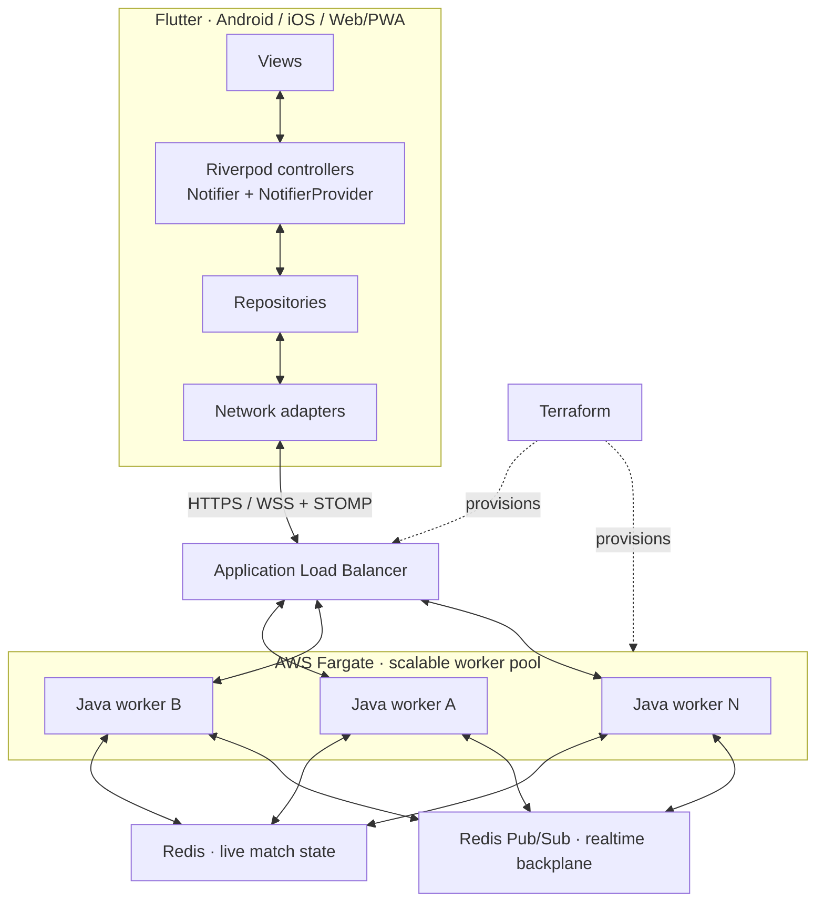

# Jogada Multiplayer

**Flutter clients. Authoritative Java rules. Match state that outlives the worker.**


A self-hosted foundation for card and turn-based multiplayer games, derived from the infrastructure behind [Jogada](https://jogada.com.br/), a live Buraco card game on Android, iOS, and the web.

Java validates online play. Redis holds live match state outside the application workers. Flutter handles presentation and connection recovery. Terraform defines the AWS deployment.

**Commercial source distribution is being prepared.** This repository contains architecture documentation, evaluation guidance, and licensing information. The application source and Terraform implementation are distributed separately under a commercial license.

[Request early access](mailto:contato@jogada.com.br?subject=Jogada%20Multiplayer%20-%20Early%20access) · [Try the live game](https://app.jogada.com.br/) · [Read the architecture](docs/architecture.md) · [Licensing and access](docs/licensing-and-access.md)

## See recovery in a real client

[](https://manoelcastillo.github.io/jogada-multiplayer/)

**[Watch the 18-second recording](https://manoelcastillo.github.io/jogada-multiplayer/)** · [Read the test report](docs/recovery-evaluation.md) · [Engineering explanation](docs/engineering/match-continuity.md)

Two real Flutter web clients join one match through different Java workers. One worker is stopped; the affected client reconnects and recovers the same match and selected player-visible state. A second scenario closes a client's WebSocket and verifies automatic recovery again.

Both scenarios passed in an isolated local run on 25 October 2026. The report identifies source versions, configuration, checks, and limits. This is functional evidence; AWS rollout, workload capacity, native platforms, billing, and plugin integration need their own release acceptance checks.

## Built for

- Developers building an authoritative card or turn-based game with a Flutter client.
- Startups that want control of the application source and their own AWS account.
- Studios that need to evaluate deployment, reconnection, and state consistency before choosing a foundation.

Game engines and rules follow a plugin architecture, making games easy to implement, add, remove, and manage while reusing the multiplayer infrastructure. The live reference game implements Buraco. See [game engine plugin architecture](#game-engine-plugin-architecture).

## Architecture at a glance



Workers A, B, and N represent a pool whose count can be adjusted to demand. Deployment capacity and scaling policies are configured for the operator's workload; the diagram does not prescribe a fixed number of workers.

[Download the SVG overview](assets/architecture.svg). This overview focuses on the live multiplayer path; persistent application data is covered in the [full architecture](docs/architecture.md).

| Layer | Responsibility |
| --- | --- |
| Flutter / Dart | Android, iOS, and Web/PWA presentation; local interaction state; connection recovery |
| Riverpod | Controllers based on `Notifier` and `NotifierProvider`, including game and lobby state |
| Repositories and network adapters | Separate application state from REST and WebSocket/STOMP transport |
| Java / Spring Boot | Authoritative runtime and plugin interface for game engines, rule validation, scoring, and match transitions |
| Redis | Shared live match state, optimistic version checks, coordination, and Pub/Sub fan-out |
| PostgreSQL | Persistent application records, separate from the live match backplane |
| AWS Fargate + ALB | Container execution, routing to healthy Java workers, and a worker pool sized for demand |
| Terraform | Reviewable infrastructure definitions for deployment in the operator's AWS account |

Clients subscribe to STOMP destinations exposed by the Java service. Redis is an internal backend dependency; clients do not connect directly to Redis.

Read the [architecture and failure model](docs/architecture.md) for the distinction between authoritative state, live event delivery, and connection lifetime.

## Technical highlights

### Server-side authority

Online clients submit intent. Java validates the action, applies the rules, and produces the resulting state. Changing client memory does not make a forged move or score authoritative.

The online client still contains presentation logic, transport handling, and user interaction state. The separate offline mode contains a local game engine and bots.

### Game engine plugin architecture

**Game engines are plugins.** Each game encapsulates its rules, move validation, scoring, and match transitions in a modular engine. This plugin architecture makes game implementations easy to add, remove, and manage while the shared runtime handles networking, shared state, reconnection, and deployment.

Plugin contracts define how each game engine integrates with the runtime. Each game also has its own client experience and, where applicable, offline engine adaptation.

### Zero-downtime deployment design

Compatible rolling deployments preserve active match state while Java workers are replaced. A client whose worker retires reconnects through the load balancer and resumes from shared state.

Here, zero downtime describes service availability and match continuity. An established WebSocket belongs to one process and may need to reconnect during replacement. State schemas, rules, and client protocols must remain compatible across the rollout.

### Seamless reconnection

After a temporary connection loss, the client re-establishes its connection, restores subscriptions, and reconciles with the current authoritative match state. Recovery depends on the match, seat, and session remaining valid.

### Infrastructure as code

Terraform defines the AWS infrastructure, including Fargate services, load balancing, networking, and data services. Buyers operate the licensed implementation in their own infrastructure.

### Cross-platform client and offline play

The Flutter client targets Android, iOS, and Web/PWA. Standalone single-player mode runs a local Dart rules engine and bots without requiring a multiplayer server. Offline results do not become authoritative online match state.

### Monetization integrations

The reference product includes subscription and checkout workflows using Stripe for the web/PWA and native in-app purchases through Google Play Billing and Apple StoreKit. Provider accounts, product configuration, and platform setup belong to the operator.

## Run locally: source workspace preview

The source implementation has a Docker development harness. These commands describe that source workspace; cloning this showcase does not install the application.

From the server source directory:

```bash
cd jogada_server
./run-local.sh 3
```

In another terminal, from the client source directory:

```bash
cd jogada_client
flutter pub get
flutter run -d chrome \
  --dart-define=JOGADA_HTTP=http://localhost:8080 \
  --dart-define=JOGADA_STOMP=ws://localhost:8080/ws
```

The backend harness starts multiple workers behind a local reverse proxy, with Redis and PostgreSQL. Initial setup requires dependency and image downloads. Live billing and other external integrations require their own development configuration.

See [local development](docs/local-development.md) for prerequisites, PowerShell/Compose commands, shutdown behavior, and the limits of this preview. The commercial release's final directory layout and installation instructions will accompany that release.

## Evaluate the behavior

The [live game](https://app.jogada.com.br/) demonstrates the player experience. It is a production service, not a public load-testing or fault-injection environment.

For technical evaluation in a local or dedicated staging environment:

1. Join the same match from two clients connected to different workers.
2. Submit moves and confirm both clients receive the updates.
3. Stop the worker serving one client.
4. Confirm that client reconnects and resumes the same match.
5. Disconnect and reconnect a client, then inspect the recovered server state.

The [evaluation guide](docs/evaluation.md) defines what to record, how to distinguish a committed move from an unacknowledged attempt, and what deployment evidence to request. The [published local evaluation](docs/recovery-evaluation.md) records one observed recovery run. No capacity, recovery-time, uptime, or support SLA is claimed by this showcase.

## Commercial licensing and access

The intended commercial package covers the Java server, Flutter client, local development tooling, infrastructure definitions, and associated documentation. The exact release contents and usage rights will be stated in the offer before purchase.

| Enquiry | Scope to discuss |
| --- | --- |
| Regular license | A defined commercial game, named developers, source access, update period, and support scope |
| Studio / enterprise license | Multiple titles or teams, agency/client delivery rights, onboarding, maintenance, and negotiated support |

Pricing, release availability, and final license terms are provided directly. There is no automated checkout or immediate-access promise in this repository.

To request access, email **[contato@jogada.com.br](mailto:contato@jogada.com.br?subject=Jogada%20Multiplayer%20-%20Commercial%20licensing)** with your game type, target platforms, team size, and intended timeline. After the release scope and terms are agreed and payment is confirmed, authorized developers receive an invitation to the private source repository.

[Read licensing and access details](docs/licensing-and-access.md).

## Documentation

| Document | What it explains |
| --- | --- |
| [Architecture](docs/architecture.md) | Authority, state flow, shared state, fan-out, and failure boundaries |
| [Local development](docs/local-development.md) | Source workspace commands and local environment behavior |
| [Technical evaluation](docs/evaluation.md) | Reconnection, worker replacement, deployment, and evidence |
| [Recorded recovery evaluation](docs/recovery-evaluation.md) | A real local run, source versions, assertions, and limitations |
| [Match continuity explained](docs/engineering/match-continuity.md) | How shared state and snapshot recovery separate match lifetime from connection lifetime |
| [Licensing and access](docs/licensing-and-access.md) | Commercial enquiries, delivery, rights, and support boundaries |
| [FAQ](docs/faq.md) | Source availability, offline play, customization, hosting, and security claims |

## About this repository

```text
jogada-multiplayer/
├── README.md
├── index.html
├── .nojekyll
├── LICENSE.md
├── CONTRIBUTING.md
├── SECURITY.md
├── AGENTS.md
├── assets/
│   ├── architecture.svg
│   ├── social-preview.svg
│   ├── social-preview.png
│   └── demo/
│       ├── README.md
├── index.html
├── .nojekyll
│       ├── recovery.mp4
│       ├── recovery.vtt
│       ├── recovery-poster.png
│       └── evaluation.json
├── docs/
│   ├── architecture.md
│   ├── local-development.md
│   ├── evaluation.md
│   ├── recovery-evaluation.md
│   ├── engineering/
│   │   └── match-continuity.md
│   ├── licensing-and-access.md
│   └── faq.md
└── .github/
    ├── ISSUE_TEMPLATE/
    │   ├── config.yml
    │   └── documentation.yml
    └── launch-checklist.md
```

Documentation corrections are welcome through [issues](https://github.com/manoelcastillo/jogada-multiplayer/issues) or the process in [CONTRIBUTING.md](CONTRIBUTING.md). Send commercial enquiries and sensitive reports by email.

## Copyright and licensing

Copyright © 2026 Manoel Castillo. All rights reserved. The original showcase materials are proprietary, subject to the exceptions in [LICENSE.md](LICENSE.md). Commercial implementation rights are granted only by a separate agreement. Third-party names and trademarks belong to their respective owners.

Maintainer: [Manoel Castillo](https://github.com/manoelcastillo) · [contato@jogada.com.br](mailto:contato@jogada.com.br)
