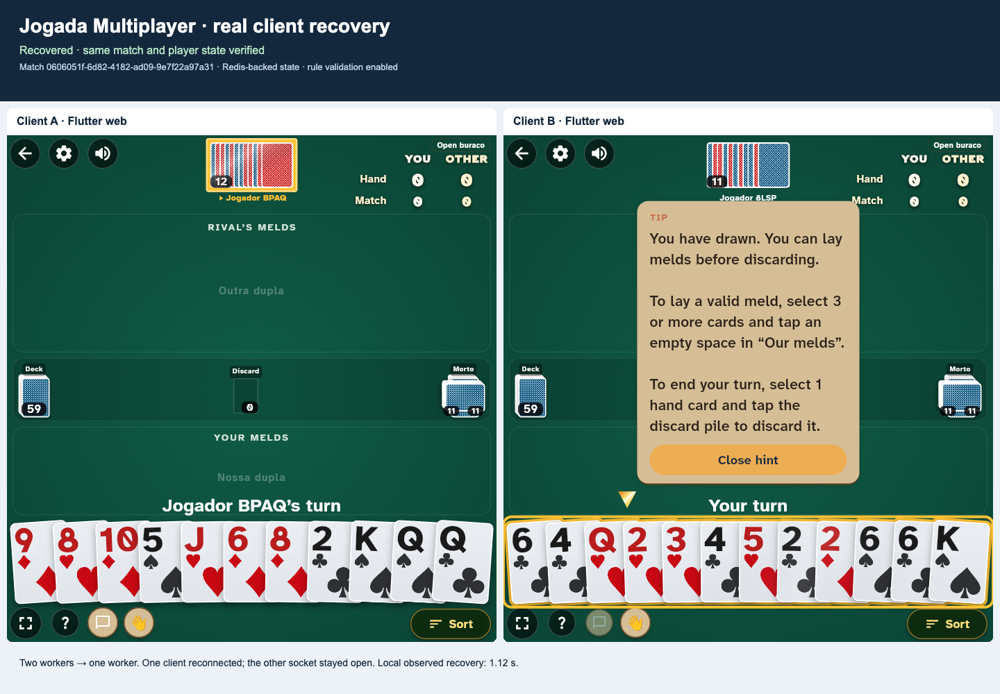
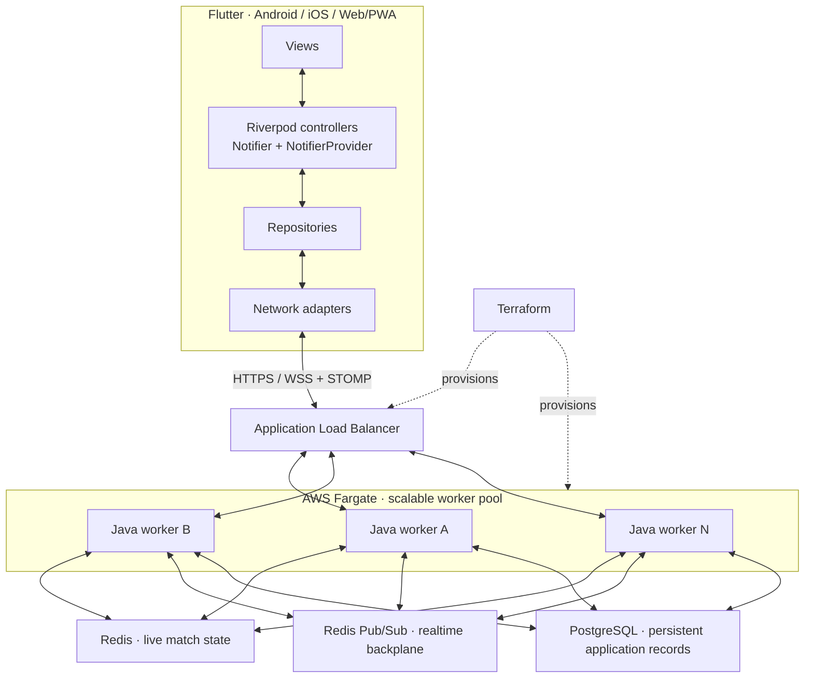

# Jogada Multiplayer

**Build your card game on a reusable Flutter + Java multiplayer foundation.**


For independent developers and small startup/studio teams starting a card or turn-based multiplayer game. Implement your rules and game screens on a foundation that supplies the multiplayer runtime, client structure, account workflows, operator tools, and deployment infrastructure.

The reference infrastructure powers [Jogada](https://jogada.com.br/), a live Buraco game on Android, iOS, and Web/PWA. Online authority lives in Java, live match state in Redis, and persistent application records in PostgreSQL. Flutter renders player-visible state and handles connection recovery.

**The commercial developer distribution is being prepared.** The package scopes and initial prices below describe the intended first licensed release. This public repository contains documentation and evaluation media; it does not contain the application implementation. Release contents and availability will be confirmed before purchase.

[Watch the recovery demo](https://manoelcastillo.github.io/jogada-multiplayer/) · [Compare features](docs/features.md) · [Licensing and access](docs/licensing-and-access.md) · [Enquire by email](mailto:contato@jogada.com.br?subject=Jogada%20Multiplayer%20-%20Developer%20licensing)

## What you build

Your Java game engine encapsulates rules, validation, scoring, and match transitions through the plugin architecture. Your Flutter screens define the game experience. If your game supports standalone offline play, you also implement its Dart rules and bots.

| Your implementation | Framework and package boundary |
| --- | --- |
| Game rules and state transitions | Java rules-plugin architecture and shared multiplayer runtime |
| Game screens and interactions | Flutter/Riverpod foundation, reusable components, themes, animations, and customization guidance |
| Offline rules and bot decisions | Separate Dart integration, demonstrated by the tutorial |
| Brand and visual assets | Replaceable themes/assets, approved starter artwork/editable files, and asset workflow guidance |
| Provider and deployment configuration | Integration points, local tooling, Terraform, and release-specific setup documentation |

Poker and blackjack are examples of games buyers may implement. Their engines are not bundled. Jogada's Buraco rules, game screens, offline engine/bots, and branding are excluded from delivery. Buyers may implement their own Buraco game within their licensed project scope.

Studio/Agency licensing is also available for agreed multi-game, multi-brand, or client deliveries. Existing-game migrations and hands-on implementation are assessed and scoped separately.

## Choose the foundation or the broader platform

Full Platform includes Core. Terraform, local development tooling, the tutorial, and a usable admin panel belong in both packages.

| Capability | Core | Full Platform |
| --- | :---: | :---: |
| Java multiplayer runtime and game-plugin architecture | Yes | Yes |
| Flutter foundation, reusable UI/themes, and approved starter assets | Yes | Yes |
| Accounts, basic profiles/avatars, guest conversion, deletion/export | Yes | Yes |
| Lobbies, matchmaking, private matches, and reconnection | Yes | Yes |
| Push notifications and in-app announcements | Yes | Yes |
| In-app player-support requests and operator replies | Yes | Yes |
| Core admin panel | Yes | Yes |
| Docker tooling, Terraform, and technical documentation | Yes | Yes |
| Original card-game tutorial: online and offline with a simple bot | Yes | Yes |
| Social/chat and persistent private rooms | — | Yes |
| Achievements, rankings, ranking events, and daily-challenge support | — | Yes |
| Player-facing match history and replay support | — | Yes |
| Stripe and native IAP billing workflows | — | Yes |
| Product analytics and complete module-specific admin console | — | Yes |
| Initial license, USD | **$499** | **$999** |
| Optional additional 12 months of updates/access, USD | **$149** | **$299** |

**Core → Full Platform upgrade: US$499** for the same licensed game/project, including a fresh 12 months of Full Platform updates/repository access and 30 days of email installation help for the added modules. See [upgrade details](docs/licensing-and-access.md#core-to-full-platform-upgrade).

The matrix describes the intended developer-release scope. Reusable module extraction and release acceptance remain in progress. Game-specific scoring, objectives, replay rendering, and provider configuration require adaptation. See the [feature catalog](docs/features.md) for boundaries and items still under scope review.

Core's admin panel covers player lookup and account blocking/unblocking, active match/lobby visibility, supported runtime settings, push/announcement management, and player-support handling. Full Platform adds administration for its additional modules and product reporting.

## See recovery in a real client

[](https://manoelcastillo.github.io/jogada-multiplayer/)

**[Watch the 18-second recording](https://manoelcastillo.github.io/jogada-multiplayer/)** · [Read the test report](docs/recovery-evaluation.md) · [Engineering explanation](docs/engineering/match-continuity.md)

Two real Flutter web clients join one match through different Java workers. One worker is stopped; the affected client reconnects and recovers the same match and selected player-visible state. A second scenario closes a client's WebSocket and verifies automatic recovery again.

Both scenarios passed in an isolated local run on 25 October 2026. The report identifies source versions, configuration, checks, and limits. This proves the recorded reference-product paths. AWS rolling deployment, workload capacity, native platforms, billing, the extracted plugin contract, and the new tutorial require their own release acceptance checks.

## Architecture at a glance



Workers A, B, and N represent a pool whose count can be adjusted to demand. Deployment capacity and scaling policies are configured for the operator's workload; the diagram does not prescribe a fixed number of workers.

[Download the SVG overview](assets/architecture.svg). Redis holds live match state; PostgreSQL stores persistent application records. The [full architecture](docs/architecture.md) explains their distinct roles and recovery boundaries.

| Layer | Responsibility |
| --- | --- |
| Flutter / Dart | Android, iOS, and Web/PWA presentation; local interaction state; connection recovery |
| Riverpod | Controllers based on `Notifier` and `NotifierProvider`, including game and lobby state |
| Repositories and network adapters | Separate application state from REST and WebSocket/STOMP transport |
| Java / Spring Boot | Authoritative runtime and plugin interface for game engines, rule validation, scoring, and match transitions |
| Redis | Shared live match state, optimistic version checks, coordination, and Pub/Sub fan-out |
| PostgreSQL | Persistent application records, separate from the live match backplane |
| AWS Fargate + ALB | Container execution, routing to healthy Java workers, and a worker pool sized for demand |
| Terraform | Reviewable infrastructure definitions for deployment in the operator's AWS account |

Clients subscribe to STOMP destinations exposed by the Java service. Redis is an internal backend dependency; clients do not connect directly to Redis.

Read the [architecture and failure model](docs/architecture.md) for the distinction between authoritative state, live event delivery, and connection lifetime.


## Technical highlights

- **Server-side authority.** Online clients submit intent. Java validates actions, applies rules, and produces player-visible state. Client memory changes do not make a forged score or move authoritative. Offline play has a separate Dart engine and bot logic.
- **Game rules as plugins.** Each game's engine integrates through the shared architecture, making implementations easier to add, remove, and manage. The framework supplies networking, shared state, recovery, and deployment; the buyer implements the game's rules and experience.
- **Zero-downtime deployment design.** Compatible rolling deployments preserve service availability and active match state while workers are replaced. Affected WebSockets reconnect. State, rules, and protocol compatibility remain deployment requirements.
- **Seamless reconnection.** Clients reconnect, restore subscriptions, and reconcile with current authoritative state while their match, seat, and session remain valid. Redis Pub/Sub provides live fan-out; recovery uses state reconciliation rather than durable Pub/Sub replay.
- **Infrastructure as code.** Both packages include Terraform for the AWS deployment and Docker development tooling. Operators configure and pay for their own infrastructure and external services.
- **A structured Flutter client.** Views, Riverpod `Notifier`/`NotifierProvider` controllers, repositories, and network adapters keep presentation and transport responsibilities explicit across Android, iOS, and Web/PWA.

Read the [architecture and failure model](docs/architecture.md) for the details behind these boundaries.

## First onboarding milestone

The intended developer release includes a small original card-game tutorial showing private hands, deck state, turn validation, the Java plugin, and Flutter integration. It also includes a separate Dart offline implementation with a simple bot. The tutorial is a developer-release requirement; its implementation and acceptance checks are pending.

The first guide will walk through:

1. Starting the local Docker backend and Flutter example.
2. Playing an online match between two clients.
3. Trying standalone offline play against the bot.
4. Modifying one example rule.

AWS deployment through Terraform follows in a separate guide. Exact tutorial rules, release paths, and runnable commands will accompany the developer release. No setup-time guarantee is attached to this sequence.

The [local development page](docs/local-development.md) also documents the existing reference workspace's commands and configuration. Those commands are an engineering preview, not instructions for installing the excluded Buraco game or a finished tutorial from this public repository.

## Developer package layout blueprint

The following shows the intended logical boundaries. Final filesystem paths will be documented with the licensed release.

```text
jogada-multiplayer-source/
├── core/                      # Java runtime, networking, state, shared platform
├── plugins/
│   └── tutorial-card-game/    # Original tutorial rules plugin
├── client/                    # Flutter foundation, modules, tutorial, offline Dart
├── dev-env/                   # Docker orchestration and neutral configuration
├── infrastructure/            # Terraform and operator setup
├── assets/                    # Approved reusable artwork and editable files
└── docs/                      # First run, plugin integration, deployment, operations
```

The plugin architecture is an integration boundary, not a catalog of bundled game engines. A visual client-wide design-system configurator is a later-release direction; the first release uses direct customization through components, themes, assets, and documentation. Custom graphic-design services are not offered.

## Licensing and private source access

A standard license covers **one game and its variations for one branded product/customer project**, including its supported Android, iOS, and Web builds and development/staging/production deployments. The entire project team, including employees and contractors working on that project, may use and modify the delivered source.

Both packages are **royalty-free**, with no software fees per instance, player, match, or developer. A combined poker-and-blackjack app needs rights for both distinct games. Additional brands or customer deliveries need separate standard licenses or an agreed Studio/Agency scope.

The purchase includes **12 months of private repository access and updates** and **30 days of written installation help by email** at [contato@jogada.com.br](mailto:contato@jogada.com.br), with a first-reply target of **two business days**. Renewal is optional: delivered versions may continue to run and be modified within the licensed scope without renewal. Calls, guided deployment, custom plugins/screens/integrations, and migrations are separately scoped services.

To enquire, email **[contato@jogada.com.br](mailto:contato@jogada.com.br?subject=Jogada%20Multiplayer%20-%20Developer%20licensing)** with your game, platforms, team, and timeline. The release, rights, and services are agreed before payment; authorized GitHub accounts then receive access to the private distribution repository through the release's onboarding process. No private repository URL or immediate-access checkout is advertised here.

Buyers operate production by default. An ongoing operations arrangement may be considered individually according to scope and availability; there is no standard managed-hosting plan or SLA. Provider accounts, infrastructure charges, and other configured external services are separate.

[Read the licensing summary](docs/licensing-and-access.md).

## Documentation

| Document | Purpose |
| --- | --- |
| [Feature catalog](docs/features.md) | Core/Full scope, customization, exclusions, and items under review |
| [Architecture](docs/architecture.md) | Authority, shared state, fan-out, persistence, and failure boundaries |
| [Local development](docs/local-development.md) | Onboarding sequence and reference workspace preview |
| [Technical evaluation](docs/evaluation.md) | What to verify in a local or staging evaluation |
| [Recorded recovery evaluation](docs/recovery-evaluation.md) | Source versions, observations, and limits of the local recording |
| [Match continuity](docs/engineering/match-continuity.md) | Match lifetime, WebSocket lifetime, and snapshot recovery |
| [Licensing and access](docs/licensing-and-access.md) | Prices, project rights, updates, support, and fulfillment |
| [FAQ](docs/faq.md) | Practical questions for buyers and operators |

## About this repository

This is a public documentation and evaluation showcase. Application source and Terraform implementation belong in the separate commercial distribution. The model is a premium source license with a public showcase; an open-source core is not offered here.

```text
jogada-multiplayer/
├── README.md
├── index.html
├── LICENSE.md
├── CONTRIBUTING.md
├── SECURITY.md
├── AGENTS.md
├── assets/                    # Architecture, preview, and recovery media
├── docs/                      # Product, architecture, evaluation, and licensing
└── .github/                   # Documentation issue templates and launch checklist
```

Documentation corrections are welcome through [issues](https://github.com/manoelcastillo/jogada-multiplayer/issues) or [CONTRIBUTING.md](CONTRIBUTING.md). Commercial enquiries and sensitive reports belong in direct correspondence.

## Copyright and licensing

Copyright © 2026 Manoel Castillo. All rights reserved. Original showcase materials are proprietary, subject to the exceptions in [LICENSE.md](LICENSE.md). Commercial implementation rights are granted by a separate agreement. Third-party names and trademarks belong to their respective owners.

Maintainer: [Manoel Castillo](https://github.com/manoelcastillo) · [contato@jogada.com.br](mailto:contato@jogada.com.br)
