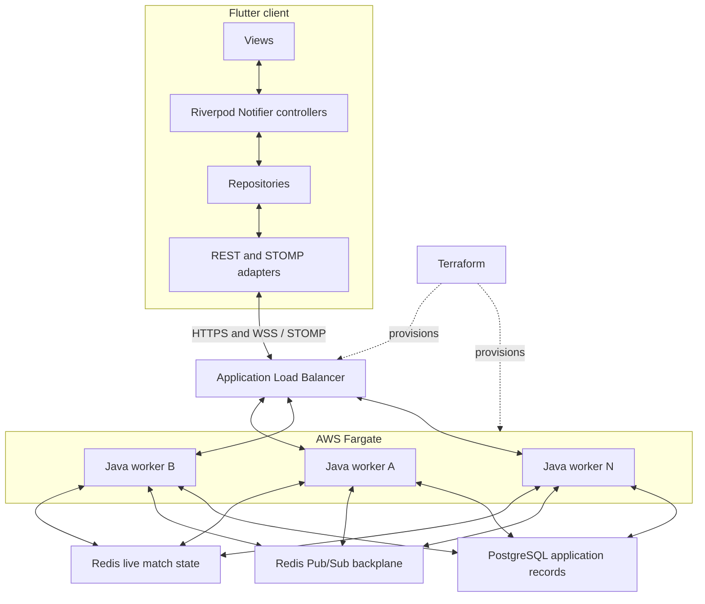

# Architecture and failure model

[Back to the overview](../README.md)

For runtime versions, Flyway migrations, virtual threads, AWS services, health/metrics, and build tooling, see [Technology stack and operations](technology-stack.md).

Jogada separates the player interface, online rule authority, live match state,
and event delivery. This document describes the reference implementation, not a
promise that the same performance or recovery behavior applies to every customization.

## Components

Terraform provisions infrastructure; it is not in the runtime request path.
Workers A, B, and N represent a horizontally scalable pool. Operators can adjust
worker count to demand, with capacity and scaling policies chosen for their
workload. Existing sockets stay attached to their workers; new capacity receives
new or re-established connections through the load balancer.

## Online authority and client state

The client sends player intent, such as a selected action and its parameters.
Java validates it against the authoritative match, applies a permitted transition,
and produces the player-visible result.

The Flutter client uses Riverpod `Notifier` / `NotifierProvider` controllers,
including `GameController` and `LobbyController`. Repositories and transport
adapters keep network access separate from state and presentation. Updates flow
back into controller state and then into the views.

The client manages selection, animation, pending actions, and connection state.
Those responsibilities do not make it the online rule authority. Hidden game
information must remain protected by server-side response construction and
subscription authorization, including after customization.

## Game engine plugin architecture in the licensed server

The licensed server follows a plugin architecture for game engines and rules.
Each game is implemented as a plugin, separating its move validation,
scoring, and match transitions from the shared multiplayer runtime. Developers
can add, remove, and manage game implementations through this modular boundary
while reusing transport, shared state, connection recovery, and deployment tooling.

Plugin contracts define how game engines integrate with the shared runtime.
The plugin boundary preserves server authority; adding, removing, or changing a game's implementation
must account for serialized state and active-match compatibility during deployment.

Game-specific client presentation and any offline engine adaptation remain part
of implementing a new game.

## State ownership and concurrency

Live matches are held in Redis outside individual JVMs. The reference store uses
versioned, atomic compare-and-set writes to reject updates based on stale state.
Conflicting operations must re-read and re-evaluate against the current match.

Redis-backed coordination also covers timer ownership and session fencing.
Deduplication and fencing protect against retried moves and obsolete connections;
these application mechanisms matter independently of the load balancer.

PostgreSQL serves persistent application records. Redis live state, PostgreSQL
records, and Pub/Sub notifications have different roles and recovery policies.

## Realtime fan-out

Workers expose STOMP subscriptions to clients. A server broadcast is published
through the Redis backplane and delivered by the workers to their local STOMP
subscribers. A player's socket and the worker applying a move can therefore be
on different instances.

Pub/Sub channels are internal fan-out, not durable queues. A subscriber that is
disconnected can miss an event. Recovery reads the current authoritative state;
resubscribing alone does not replay the missing messages.

See [Redis Pub/Sub delivery semantics](https://redis.io/docs/latest/develop/pubsub/#delivery-semantics).

## Worker replacement and compatible deployments

An established WebSocket is attached to a particular process. A replacement JVM
cannot inherit that connection. The client reconnects through the load balancer,
restores subscriptions, and requests the state needed to resume the active match.

With overlapping healthy capacity and compatible versions, rolling deployments
can preserve service availability and match continuity while workers change.
Terraform's ECS service configuration and target draining support that rollout;
shared state and client recovery preserve the match across it.

Compatibility must cover serialized match data, client payloads, rule behavior
for existing matches, and any associated database schema changes. Breaking changes
need versioning, migration, or an explicit drain strategy. Redis alone does not
make an incompatible deployment safe.

See [ALB WebSocket routing](https://docs.aws.amazon.com/elasticloadbalancing/latest/application/edit-target-group-attributes.html#sticky-sessions)
and the [evaluation guide](evaluation.md).

## Recovery boundaries

| Event | Expected mechanism and boundary |
| --- | --- |
| One Java worker is replaced | Clients reconnect to healthy capacity and recover valid matches from shared state. |
| A client temporarily loses connectivity | It reconnects and reconciles with the current match, subject to seat, grace, session, and match validity. |
| A notification is missed | State resynchronization repairs the client view; Pub/Sub does not replay it. |
| Two workers attempt conflicting updates | Version checks reject stale writes so the application can retry against current state. |
| Redis is unavailable or loses data | Behavior depends on retry, availability, persistence, and failover configuration; worker-replacement resilience is not a Redis disaster-recovery guarantee. |
| A rollout changes rules or wire formats incompatibly | A migration or versioning strategy is required before promising continuity. |

Turn timers and match rules can advance while a player is disconnected. Reconnection
restores the current valid state; it does not promise to pause the game.

## Offline mode

Standalone single-player play uses a local Dart engine and local bots. It does not
depend on a running Java service. That local authority is confined to offline play;
local results are not treated as authoritative multiplayer state.

## Scope

This foundation comes from a card-game product. Domain adaptation, deployment
sizing, monitoring, data retention, and provider configuration remain engineering
work for the operator. No universal latency, capacity, cheat-prevention, or uptime
guarantee follows from the component choices alone.
