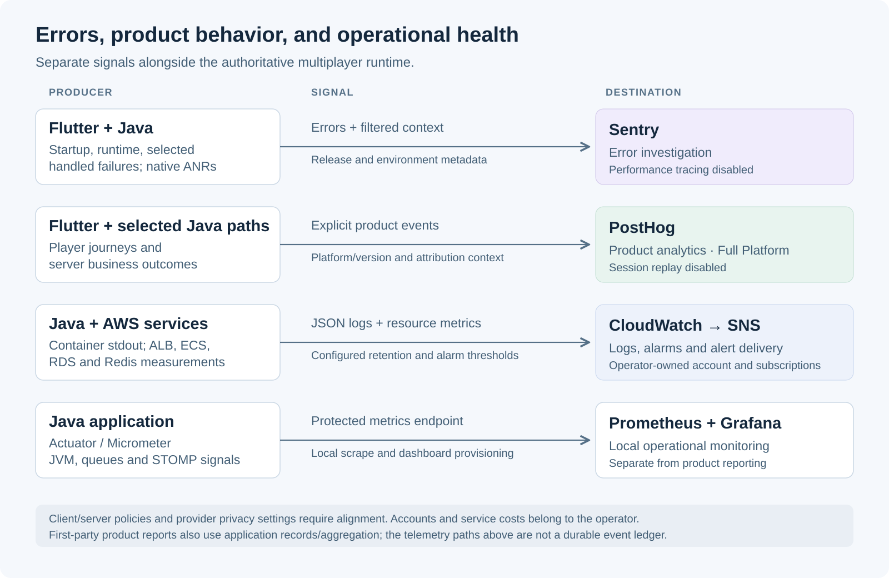

# Observability and analytics

[Back to the overview](../README.md) · [Architecture](architecture.md) · [Technology stack](technology-stack.md) · [Core/Full features](features.md)

The reference system includes error reporting across the Flutter client and Java backend, explicit product-event instrumentation, first-party reporting, and infrastructure/application monitoring. These signals help developers discover failures, investigate regressions, understand player friction, and operate the service.

This inventory was checked against source/configuration on **26 October 2026**, using server `0fc65815aac2f0c38f9349c3705b62fa1d49d360` and client `9647660a89b2d813981837460f3cee0607950eb2`. It documents implemented reference capabilities. Neutral extraction, buyer-owned destinations, Core/Full separation and commercial release acceptance are still in progress.

## Signal flow

The diagram shows diagnostic and measurement paths alongside gameplay. Telemetry does not supply authoritative match state, and a captured analytics event does not grant an entitlement or prove payment. First-party product reports also use application records and aggregation; their data is not simply a copy of PostHog dashboards.

## Sentry: errors from startup through gameplay

The Flutter `CrashSink` abstraction has a Sentry adapter, allowing application features to report faults without directly depending on the vendor SDK. Its implemented coverage includes:

- **Startup and initialization failures:** a bounded pre-initialization buffer retains early errors/breadcrumbs while the SDK becomes ready; startup integrations report selected initialization failures.
- **Framework and asynchronous failures:** Flutter error handling, the platform dispatcher and the guarded boot zone route errors into the crash-reporting path.
- **Selected handled errors:** features can report a caught failure even when the app displays a recoverable error state. This includes selected authentication and audio/license-loading paths, rather than only terminal crashes.
- **Supported native ANR reporting:** the client explicitly enables the SDK's ANR capability; capture and diagnostic depth depend on platform/build behavior.
- **Diagnostic breadcrumbs:** match lifecycle, foreground/background transitions and route templates provide context without copying the entire rendered screen or raw route parameters.
- **Release/environment identification:** client reports carry the visible app release and configured environment, making it possible to compare failures across versions and distinguish staging from production.

The Java backend uses Sentry's Spring Boot integration for error reporting and stack traces. Expected domain exceptions are filtered from defect reports. Build-aware release identification uses available image build metadata, subject to explicit configuration overrides; missing metadata should not be replaced with an invented release.

The inspected client/backend configuration disables Sentry performance tracing. Automatic client screenshots are also disabled. Error reporting helps expose failures once the relevant code path executes; it is complementary to CI checks and tests, and does not discover every defect before users encounter it.

## PostHog: explicit product-event instrumentation

The Flutter `AnalyticsSink`/service boundary defines event contracts and vendor adapters. The reference PostHog integration receives explicit events rather than treating every tap as a useful product metric. Web autocapture and automatic pageview capture are disabled in the inspected initialization; the app supplies its own relevant signals.

| Event family | Questions the instrumentation supports |
| --- | --- |
| Entry, guest access and authentication | Did the app open, did guest entry succeed, and where did login/OTP fail or complete? |
| Onboarding and activation | Which onboarding steps were reached, and did a player reach an accepted gameplay milestone or finish a first game? |
| Matchmaking and play | Did a player enter a queue, find/join a match, start/finish a game, abandon a wait, or leave a match? Game-specific milestones need adaptation. |
| Offline use and return to online play | Was local practice used, how did the session end, and did a handoff lead to sign-in/online use? The reference Buraco engine/content is excluded from delivery. |
| Connection and lifecycle behavior | What drops/reconnects occurred, and how much observed downtime overlaps background time versus active recovery? These are diagnostic/product signals, not a latency guarantee. |
| Purchase journeys | Was an offer seen, checkout opened/cancelled/failed, or an entitlement later confirmed? Client intent is distinct from a verified provider outcome. |
| Attribution and artifact context | Which source/campaign, platform, app version and build channel produced an event? QA markers help identify explicitly labeled test traffic. |

The Java integration can emit selected server-side checkout/payment/refund events through a best-effort PostHog capture client. The reviewed purchase path schedules sale/refund analytics after the database commit and excludes recorded test environments from those sale events. This does not make the telemetry transport a durable ledger or an exactly-once outbox; financial truth remains in authoritative application/provider records.

Event identities are pseudonymous, and client events carry explicit artifact/platform properties. Product analysis still requires careful event definitions, cohort windows, test-traffic exclusions, instrumentation of the buyer's game, and validation of actual provider ingestion. Event presence alone does not establish a meaningful retention result or conversion rate.

PostHog session replay is **disabled** in the inspected native and web configuration. PostHog-based feature flags, experiments and surveys are not advertised here as completed integrations. Deeper use of the service is separate work from documenting the existing event foundation.

For SDK configuration details, see [PostHog's Flutter integration documentation](https://posthog.com/docs/libraries/flutter).

## First-party analytics and provider adapters

The Full Platform reference includes backend reporting for player activity, retention/cohorts, acquisition and conversion, using application telemetry/business records and aggregation. Operator views can filter relevant connection-health information by platform/version and inspect acquisition/retention reports. The commercial extraction must replace Jogada-specific events, scoring and business assumptions.

PostHog is one analysis destination. Selected conversion events also have platform-specific Firebase Analytics/GA4 bridges with narrower event/property allowlists. Those integrations have their own availability, configuration and measurement controls; the general PostHog event payload is not forwarded wholesale to every provider. No automatic advertising-spend integration or ready-made dashboard for every game is implied.

## Operational health, logs, metrics, and alerts

| Layer | Implemented visibility |
| --- | --- |
| Process and dependencies | Actuator liveness/readiness probes; readiness includes PostgreSQL, Redis and the STOMP broker, with bounded transient Redis-outage tolerance |
| Application behavior | Micrometer measurements for JVM/application state, matchmaking/queues and supported STOMP channel/connection behavior |
| Log investigation | Production JSON stdout logs collected through ECS `awslogs` into CloudWatch; correlation context for HTTP/STOMP paths and serving build information |
| Infrastructure pressure | CloudWatch alarm definitions for healthy ALB targets, target errors/latency, ECS CPU/memory, RDS CPU/storage/connections, Redis CPU/evictions and SMS spend |
| Alert delivery | Operator-configured SNS email subscriptions; thresholds, recipients and delivery must be verified in the buyer's account |
| Local monitoring | Docker Compose plus provisioned Prometheus/Grafana configuration and dashboards; protected metrics endpoints require appropriate credentials |
| Edge traffic | Configurable ALB and web-CDN access logs with retention/access settings, separate from application error reports |

Sentry answers questions about faults and execution context. CloudWatch and application metrics answer questions about health, pressure and operational events. Product reports and PostHog answer behavioral/business questions. Correlating their time windows, releases and environments is more useful than treating one dashboard as complete evidence of system health.

## Controls and failure boundaries

- **Telemetry adapters:** crash and analytics interfaces keep provider calls out of feature code. Unconfigured adapters can be no-ops; the release must provide neutral defaults so local development does not report to Jogada projects.
- **Client product-analytics suppression:** player opt-out and an operator kill switch gate configured client analytics, with SDK-level suppression and property filtering. The kill-switch path uses the lobby pulse with a polling fallback.
- **Server policy alignment:** server business-event analytics has a separate policy path. The reviewed emitter checks an operator analytics opt-out override; a local client preference or client kill switch must not be assumed to suppress every server event automatically. Release acceptance must verify the intended shared policy.
- **Data minimization:** client error scrubbing targets recognized sensitive strings and filters breadcrumb categories; route breadcrumbs use templates. Automatic screenshots and client console breadcrumbs are disabled. Scrubbing is not a guarantee that arbitrary custom payloads are safe.
- **Provider-side controls:** native-origin crash events and provider-derived metadata can bypass Dart-only scrubbing. Operators must review their Sentry project settings, native/browser integrations, access, retention and processing region.
- **Failure isolation and delivery:** client analytics calls are guarded; fan-out isolates vendor failures. Native PostHog batching has configured queue/batch bounds; backend capture is asynchronous and best effort. Missing telemetry is not proof that no gameplay failure or purchase occurred.

## Package and operator responsibilities

| Scope | Included delivery boundary |
| --- | --- |
| Core and Full | Client/backend error-reporting foundation, operational health/log/metric/alert integration and associated setup documentation, subject to extraction and release verification |
| Full Platform | Product-journey instrumentation, PostHog adapter, activity/retention/cohort/acquisition reporting and corresponding module administration |
| Operator | Provider projects/credentials, matching client/server destinations, regions, access policies, retention, sampling, alert recipients, costs and game-specific event adaptation |

Provider subscriptions, hosted dashboards and paid service quotas are separate from the software license. Product reporting remains distinct from Core's active match/lobby visibility and operational diagnostics. See the [feature catalog](features.md) and [licensing summary](licensing-and-access.md).

## Release evaluation checks

Use test-only destinations in a local or designated staging environment:

1. Trigger a controlled client error and a controlled backend error; verify the correct release/environment, stack/context and expected-domain-error filtering. Include selected handled and pre-initialization client failures.
2. Exercise a short entry → match → result journey and a provider-sandbox purchase flow where included. Confirm event meanings, pseudonymous identity, artifact/platform tags and authoritative versus client-observed outcomes.
3. Test client opt-out/operator suppression and the separate server policy, including queued events and account changes. Inspect native/browser provider metadata and custom event properties.
4. Make optional telemetry unavailable and confirm its failure does not become an unhandled player-path error. Verify queue/flush behavior without claiming durable event delivery.
5. Observe the supported application metrics/logs and a controlled infrastructure alarm. Confirm alert delivery, retention and permissions in the operator's account.

These are evaluation requirements. Preparing this page did not trigger real errors, send events, inspect private provider dashboards, run a cloud deployment or validate the commercial release. The existing [recovery report](recovery-evaluation.md) remains narrower evidence for its recorded interruption scenarios.
